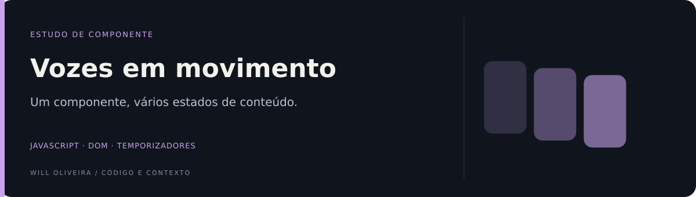

<p align="center">
  
</p>

# Depoimentos · componente com rotação automática

Estudo de um cartão de depoimentos que alterna conteúdo, avatar, nome, função e cor de fundo.

**HTML · CSS · JavaScript**

Exercício da série 50 Projects para praticar temporizadores e atualização do DOM.

## Explore o diferencial

| Ponto de entrada | O que observar |
| --- | --- |
| [Rotação de conteúdo](script.js) | Uma lista de dados e um temporizador atualizam o mesmo cartão. |
| [Transição visual](style.css) | Avatar, texto e apresentação compõem um pequeno componente de feedback. |

## Destaques

- Dados de demonstração organizados em uma lista.
- Atualização periódica dos elementos da interface.
- Variação visual entre os depoimentos.

<details>
<summary><strong>Organização e código</strong></summary>

### Por dentro do código

| Arquivo | Responsabilidade |
| --- | --- |
| [`script.js`](script.js) | Dados e rotação dos depoimentos. |
| [`index.html`](index.html) | Markup do cartão. |
| [`style.css`](style.css) | Apresentação e animação. |

</details>

<details>
<summary><strong>Executar e consultar</strong></summary>

### Executar localmente

Clone o projeto e sirva a pasta com um servidor estático. Com Python 3 instalado:

```bash
git clone https://github.com/Will-Ifes/project47_testimonial.git
cd project47_testimonial
python3 -m http.server 8080
```

Abra http://localhost:8080. Não há instalação de dependências ou etapa de build.

</details>

<details>
<summary>Escopo e referências</summary>

Os textos são dados fictícios de demonstração, não recomendações profissionais recebidas.

</details>

---

Mantido por **Will Oliveira** · [Perfil](https://github.com/Will-Ifes) · [LinkedIn](https://www.linkedin.com/in/wildemberg-de-jesus-oliveira/)
